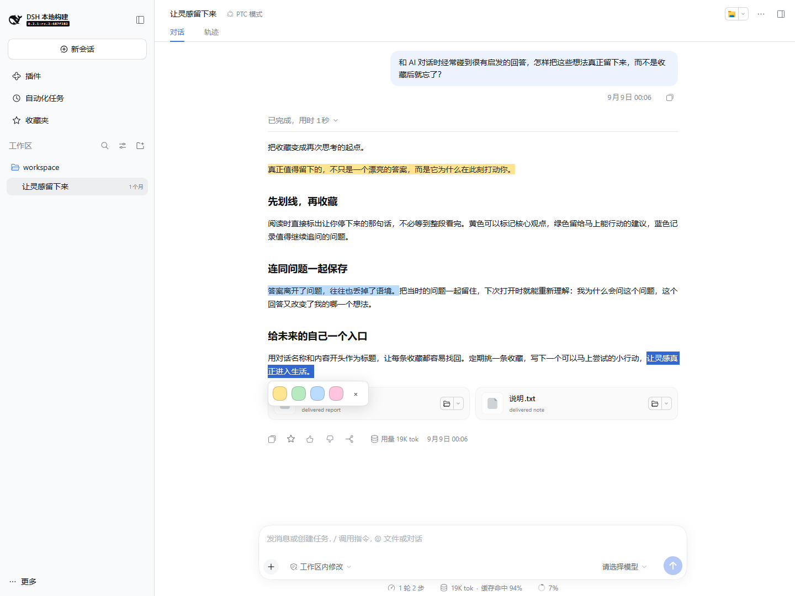
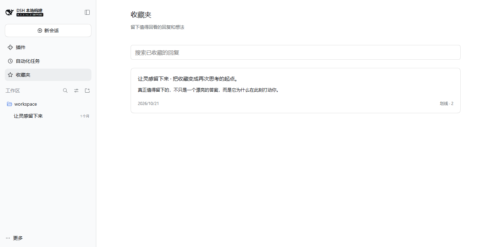
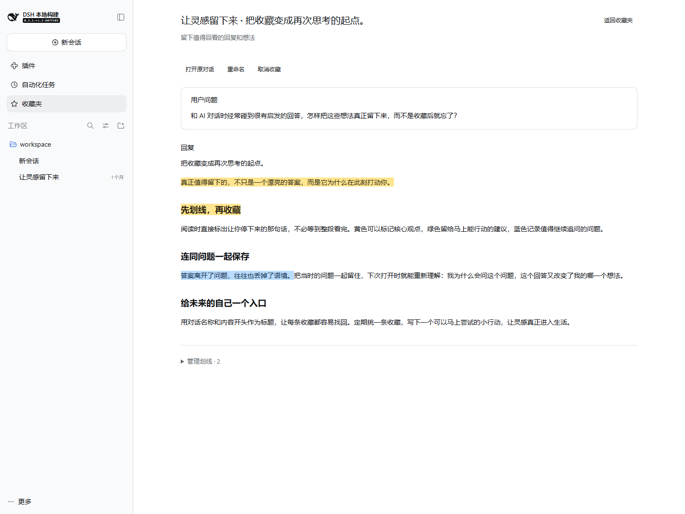

# 阅读收藏

[中文](README.zh.md) | [English](README.md)

> **兼容版本：** 插件 `0.1.2` 要求 **DSH `0.2.1-rc.2` · Web 端**。
>
> `package.json` 中的 `engines.dsh` 精确限定此版本。其他 DSH 版本（包括更新版本）及桌面端安装尚未验证。

## 概述

阅读回复时直接划线，读完后将整条回复与全部标记一起收藏。划线在收藏前就会自动保存。收藏夹保留回复副本，原会话删除后仍可阅读。这个可选 bundle 为你的 Web profile 添加收藏夹。

## 目录

- [效果展示](#screenshots)
- [使用](#use-this-package)
- [实现](#understand-the-implementation)
- [模型体验](#model-experience)
- [已知限制与后续工作](#known-limitations-and-deferred-work)
- [社区与贡献](#community-and-contribution)
- [开发备注](#dev-note)

<a id="screenshots"></a>
## 效果展示

以下截图使用中文界面的本地示例会话；插件同时支持中文与英文。

边读边划线：选中文字并选择颜色，无需先收藏。



在收藏夹中，通过对话名称和回复开头识别已保存的内容。



打开收藏，同时回看当时的用户问题、完整回复和彩色划线。



<a id="use-this-package"></a>
## 使用

通过插件页面或 CLI，将提供的 `dsh-reading-collection-0.1.2.tgz` 安装到 Web profile，然后重启该 profile。使用并列的 `DSH` 和 `DSH_plugin/reading-collection` 目录时，在 Harness 源码仓库中运行：

```sh
pnpm dsh plugin --profile web add ../DSH_plugin/reading-collection/artifacts/dsh-reading-collection-0.1.2.tgz
```

在已完成的回复中选中文字，再选择黄色、绿色、蓝色或粉色。点击已有划线可改色或删除。回复下方的五角星按钮默认会把完整 Markdown、已有划线和对应的用户问题一起收藏。默认标题为“对话名称 · 回复开头”，之后可以重命名。从侧栏打开收藏夹，可搜索回复、已保存的问题与划线，重命名收藏、阅读、编辑划线或打开原对话。收藏中的彩色划线直接显示在回复原文中，也支持跨 Markdown 块的选区；下方“管理划线”默认收起，需要查看摘录或使用管理控件时再展开。取消收藏会保留划线草稿。

主机提交成功后，界面才会显示已保存。操作失败会保留已有数据，并提供重试。数据使用 profile 配置的存储提供方，保存在 Harness 主目录下的 `reading_collection` 存储域中。卸载 bundle 会移除界面，不会删除数据。

开发插件时，在此目录运行 `pnpm install`、`pnpm run typecheck`、`pnpm test` 和 `pnpm run pack:bundle`。bundle 有自己的锁文件，不修改 Harness 工作区的依赖关系。

此目录是独立的 Git 仓库。插件的 Git 操作在此目录运行，Harness 的 Git 操作在 DSH 源码目录运行。运行 `pnpm run prepare:smoke --dsh-root D:/00-code/DSH` 可准备无密钥的录制会话检查；省略 `--dsh-root` 时使用并列的 `DSH` 目录。脚本输出隔离的测试路径，不会启动服务器。

<a id="understand-the-implementation"></a>
## 实现

<details>
<summary>实现细节</summary>

Profile 补丁挂载一个主机插件和对应的浏览器贡献。主机验证仅所有者可调用的 RPC 请求，并按顺序写入带版本的存储记录。浏览器通过 Chat、侧栏、主面板和浮层插槽添加功能。适配当前版本的 DOM 适配器将选区对应到已完成的 Chat 节点，使用 CSS Custom Highlight 绘制，不修改 React 管理的正文。原文摘录和前后文用于在布局变化后定位划线，并将 Markdown 分隔换行的差异映射回实际正文位置；无法唯一定位时不绘制，已保存的摘录仍可查看。

</details>

<a id="model-experience"></a>
## 模型体验

此 bundle 不添加模型工具或提示词。收藏与标记属于个人阅读数据，不进入模型上下文。

<a id="known-limitations-and-deferred-work"></a>
## 已知限制与后续工作

收藏前需先在当前对话历史中加载对应的用户问题；暂不复制问题中的附件。未保存问题的旧收藏仍可阅读，并显示提示。仅支持带标准操作行的已完成文字回复。不支持流式生成中的回复、思考过程、图片、自由手绘或跨回复选区。文字高亮需要支持 CSS Custom Highlight 的新版浏览器。DOM 适配器限定于声明的 DSH 版本；桌面端安装尚未验证。其他浏览器窗口在获得焦点时刷新收藏；首版不包含多窗口实时更新和收藏导出。打开来源会返回原对话，不会自动翻页到具体历史消息。

<a id="community-and-contribution"></a>
## 社区与贡献

这是独立维护的社区插件。DSH [贡献指南](https://github.com/deepseek-ai/deepseek-harness/blob/master/CONTRIBUTING.zh.md)建议插件作者为 GitHub 仓库添加 [`dsh-plugin`](https://github.com/topics/dsh-plugin) 话题，方便其他人发现项目。插件问题与改进建议请提交到[本仓库的 Issues](https://github.com/zzh-github/dsh-plugin-sparknote/issues)。

<a id="dev-note"></a>
## 开发备注

无。
